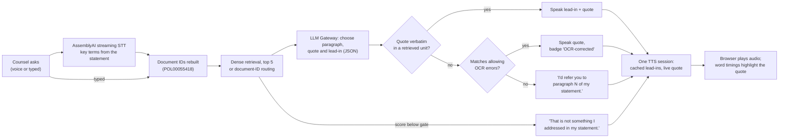
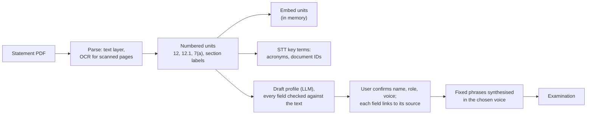

# Cross-examine

**Cross-examine a witness on their own statement, by voice. Every answer is a verified quote, spoken and highlighted as it's read.**

For lawyers and trainees preparing cross-examination.

[](environment.yml) [](LICENSE)

| Result | Count | Source |
|---|---|---|
| Counsel's real questions from the hearing, never used in development: answered from the right paragraph | **11 of 15**, plus **3 of 5** trap questions refused; every answer a verified quote | [run_20261024_ismay_heldout](eval/results/run_20261024_ismay_heldout.json) |
| Uploaded statements never used in development: answered from the right unit | **7 of 8**, plus **4 of 4** trap questions refused | [run_20261023_upload_heldout](eval/results/run_20261023_upload_heldout.json) |
| Example witness (questions used during development): answerable questions answered from the right paragraph | **27 of 28**, in each of 3 runs | [run_20261024_ismay_dev](eval/results/run_20261024_ismay_dev.json) |
| Answers that were verified quotes | **83 of 83** across 3 runs; nothing unverified was spoken | same |
| Question to the witness's first audio (voice reply) | **p50 1,063 ms, p95 2,250 ms** over 35 questions (rate-limit waits excluded) | [run_20261024_ismay_live](eval/results/run_20261024_ismay_live.json) |

Every answer is quoted from the statement or refused; none are generated.

<!-- TODO: live URL -->
<!-- TODO: demo GIF -->
<!-- TODO: screenshot of the examination screen -->

A solo project for AssemblyAI's Voice Hackathon, October 2026.

## Problem and approach

Practising cross-examination needs a witness who sticks to their evidence. A language model playing the witness will happily invent a convenient answer, and counsel can't tell. That makes it worse than useless for preparation: you rehearse against testimony that doesn't exist.

Here the witness can only answer by quoting their own written statement. The model picks the paragraph and the words; code checks that the words are really there before anything is spoken, and the quoted words are highlighted in the statement as the voice reads them.

[](https://gitdiagram.com/ishaan-bhalla/cross-exam?utm_source=readme&utm_medium=picture)

*Architecture diagram (GitDiagram; click to explore it interactively). The two flows below show the examination and upload steps in detail.*

**Examination**



**Upload**



### Key design choices

| Choice | What was measured | Source |
|---|---|---|
| **Extractive answers.** The model may only quote; code verifies the quote is a verbatim extract of a retrieved unit before it is spoken. | Every answer in the dev set was a verified quote: 28, 27 and 28 answered in the 3 runs, all verified. | [ismay_dev](eval/results/run_20261024_ismay_dev.json) |
| **Dense retrieval** (BAAI/bge-small-en-v1.5) over BM25 or hybrid. | Right paragraph in the top 5 for 27 of 28 answerable questions; BM25 20, best hybrid 27 but only 23 at rank 1 against dense's 25. | [retrieval ablation](eval/results/run_20261024_ismay_retrieval_ablation.json) |
| **Document-ID routing.** A question citing an ID (POL00055418) is answered from the units that cite it. | Document questions with the right unit first: 4 of 4 with routing, 2 of 4 without. | [no routing](eval/results/run_20261024_ismay_retrieval_dense_no_routing.json) |
| **HyDE: tried, left off.** | Right paragraph in top 5: 22 of 28 (dense + HyDE), 24 (hybrid + HyDE), against 27 for dense alone. | [dense + HyDE](eval/results/run_20261024_ismay_retrieval_dense_hyde.json), [hybrid + HyDE](eval/results/run_20261024_ismay_retrieval_hybrid_hyde.json) |
| **LLM relevance check: tried, left off.** | Right paragraph 22–23 of 28 with it, 27 without; median latency 2,025 ms against 1,104 ms. It refused 7 of 7 traps every run, against 6–7 without. | [relevance check on](eval/results/run_20261024_ismay_dev_relevance_check_on.json) |
| **Cross-encoder reranker: tried, left off.** | Right paragraph 26 (MiniLM-L-6) and 25 (bge-reranker-base) of 28, against 27 without; no gain on uploads. | [reranker runs](#reranker) |
| **Referral instead of a fallback quote.** If no quote verifies, the witness names the paragraph rather than quoting something unverified. | With OCR-tolerant matching off, the 2 OCR questions in the upload dev set become referrals to the right unit in every run. | [OCR off](eval/results/run_20261024_upload_dev_ocr_verify_off.json) |
| **OCR-tolerant verification**, a second pass for scanned statements. | Those 2 referrals become spoken quotes with an "OCR-corrected" badge (2 per run), with no other answer changing. | [upload_dev](eval/results/run_20261024_upload_dev.json) |
| **One TTS session per examination, with cached lead-ins and refusals.** | 35 answers on one session; refusals decided before the LLM start playing in 5–13 ms; for answers, first audio is the cached lead-in, so it lands as soon as the answer is known. | [ismay_live](eval/results/run_20261024_ismay_live.json) |

### Data

Witness statements published by the [Post Office Horizon IT Inquiry](https://www.postofficehorizoninquiry.org.uk/), which are public documents.

| Document | Use | Downloaded |
|---|---|---|
| [WITN04630100, Rod Ismay, first witness statement](https://www.postofficehorizoninquiry.org.uk/evidence/witn04630100-rod-ismay-first-witness-statement) | The example witness and the dev set | 19 Oct 2026 |
| INQ00001063, transcript of 11 May 2023 ([hearing page](https://www.postofficehorizoninquiry.org.uk/hearings/phase-3-11-may-2023)) | Counsel's real questions for the held-out set | 19 Oct 2026 |
| 135 further witness statements | Parser tests and the two upload sets | 22 Oct 2026 |

`data/` is not in the repo; see [Getting started](#getting-started).

## Trustworthiness

| What you see | What it means |
|---|---|
| A quote with the words highlighted as they're spoken | The words were found verbatim in the highlighted unit before the answer was spoken. The paragraph number is shown as a badge. |
| "That is not something I addressed in my witness statement." | A refusal: nothing retrieved scored above the gate, or the model found no paragraph that answers. No quote is invented. |
| "I'd refer you to paragraph N of my statement." and a "Referred, not quoted" badge | The model's quote did not verify, so nothing is quoted. The unit is highlighted whole. |
| An "OCR-corrected" badge | The statement's scanned text has OCR errors ("lama" for "I am a"). The quote matched only after allowing for them: every word aligned, no words added or missing. The witness says the corrected words; the original words are highlighted. |
| "Document reference" badge | The question cited a document ID and was answered from the units citing it. An ID that isn't in the statement gets "I don't recognise that document reference". |

**Retries and errors.** There is no backup model:
- **LLM:** a rate-limited call (HTTP 429) is retried up to `LLM_MAX_RETRIES` (4), waiting for `Retry-After` or backing off; any other failure is shown as an error and the question can be asked again. In the live run 2 of 35 questions waited (71 s in total).
- **TTS:** opening a session retries on the account's session limit (`TTS_SESSION_RETRIES`, 3), and a dropped session is reopened. If word timings never arrive, the audio still plays without highlighting.
- **STT:** if the microphone or speech-to-text fails, you can type the question instead.

**Cost and latency logging.** Every answer records LLM calls and tokens in and out (from the gateway's usage field), TTS characters and audio seconds synthesised live (from each flush; their sum matched the session's `Termination` totals exactly, 4,513 characters and 266.72 s, in the live run), STT audio seconds for spoken questions, and latency. Add `?debug` to the examination URL to see it under each answer. Cost is estimated from rates in `.env` (`COST_*`); the rates are left empty here because they aren't known, so cost shows as "not measured".

**Why there is no local option.** The app is built on AssemblyAI's voice stack: streaming speech-to-text, streaming text-to-speech and the LLM Gateway. Embeddings and OCR run locally, but swapping in local speech or language models would change every measured number above. An uploaded statement is held in memory only (unless `PERSIST_UPLOADS` is on), but its text is sent to AssemblyAI to run the examination.

## Evaluation

### Test sets

| Set | File | Size | Coverage | How it was built |
|---|---|---|---|---|
| Ismay dev | [`eval/ismay_questions.jsonl`](eval/ismay_questions.jsonl) | 35 | 12 direct, 8 paraphrased, 4 multi-paragraph, 5 document references (1 citing an ID not in the statement), 6 traps (3 off-topic, 3 Inquiry topics he doesn't address) | Written against the statement. Every setting was chosen on it, including the refusal gate, so its numbers are optimistic. |
| Ismay held-out (counsel's questions) | [`eval/ismay_heldout.jsonl`](eval/ismay_heldout.jsonl) | 20 | Counsel's questions from Mr Ismay's oral evidence | Taken from the 11 May 2023 transcript and labelled against the statement; not used for any decision. |
| Upload dev | [`eval/upload_spotcheck.jsonl`](eval/upload_spotcheck.jsonl) | 20 | 3 statements: witn09180100 (mostly scanned), witn06700100 (sub-paragraphs such as 103.9), witn09830100 (168 pages). Per statement 3 answerable, 1 document reference, 2 traps; plus 2 OCR questions | Written before the first run. Used to decide the reranker and OCR changes, so now a development set. The 2 OCR questions were added after the OCR fix. |
| Upload held-out | [`eval/upload_heldout.jsonl`](eval/upload_heldout.jsonl) | 12 | 2 statements not used before (witn10660100_0, witn09910100_1), same mix | Written and checked (trap terms grepped) before any run; run once. |

### Metrics

| Metric | Definition |
|---|---|
| hit@1, hit@k | An expected unit is ranked first / in the top 5 retrieved (answerable questions). |
| Right unit | The answer cites an expected unit (answerable questions). Referrals count when they name an expected unit. |
| Grounded | Of the questions answered (not refused), those where no unverified words were spoken: a verified quote, an OCR-corrected quote or a referral. |
| Verified | Answered with an exact verbatim quote. |
| Traps refused | Of the unanswerable questions (traps, and the unknown document ID), those refused. |
| Latency | Question in to answer decided, excluding time waiting on LLM rate limits. The live run also measures first audio. |

### Results

Ismay dev, final settings, 3 runs ([run_20261024_ismay_dev](eval/results/run_20261024_ismay_dev.json)). Where runs differ, the range is shown.

| | Count | Rate |
|---|---|---|
| hit@1 | 25 of 28 | 89% |
| hit@k | 27 of 28 | 96% |
| Right unit | 27 of 28 | 96% |
| Grounded | 28 of 28, 27 of 27, 28 of 28 | 100% |
| Verified (exact) | all of those | 100% |
| Traps refused | 6–7 of 7 | 86–100% |
| Answerable questions refused | 1 (p06) | |

Held-out and upload sets:

| Set | Runs | Right unit | Grounded | Verified (exact) | OCR-corrected | Referrals | Traps refused | Source |
|---|---|---|---|---|---|---|---|---|
| Ismay held-out (counsel) | 1 | 11 of 15 | 15 of 15 | 15 | 0 | 0 | 3 of 5 | [ismay_heldout](eval/results/run_20261024_ismay_heldout.json) |
| Upload dev | 3 | 10 of 14 | 15–16 of 15–16 | 13–14 | 2 | 0 | 4–5 of 6 | [upload_dev](eval/results/run_20261024_upload_dev.json) |
| Upload held-out | 1 | 7 of 8 | 7 of 8 | 7 | 0 | 0 | 4 of 4 | [upload_heldout](eval/results/run_20261023_upload_heldout.json) |

Counsel's questions are harder than the dev set: the right paragraph is ranked first for 8 of 15 (25 of 28 on dev) and in the top 5 for 14 of 15. Of the 4 answerable misses, 2 were refused (h09, whose paragraph ranks 7th, and h11) and 2 quoted a real but wrong paragraph (h14, h20). Two traps were answered with real quotes that don't address them (h04, h16). Seven of the 15 answerable questions are labelled low-confidence in the question file (`label_confidence`); on the 8 high-confidence ones the right paragraph was cited for 7.

The held-out upload run was made before referrals existed: its one ungrounded answer (u4-docref) spoke the first sentence of the right paragraph instead of the reason asked for. That answer is now a referral to ¶51 (replayed from the recorded model reply in [`tests/test_referral.py`](tests/test_referral.py)); the set has not been rerun, since it has been used once.

### By question type

Ismay dev (counts the same in all 3 runs unless a range is shown; p50 latency is the mean over runs):

| Type | n | hit@1 | Right unit | Refused | p50 latency |
|---|---|---|---|---|---|
| direct | 12 | 12 | 12 of 12 | 0 | 1,207 ms |
| paraphrased | 8 | 6 | 7 of 8 | 1 | 1,136 ms |
| multi-paragraph | 4 | 3 | 4 of 4 | 0 | 1,899 ms |
| document reference | 5 | 4 of 4 | 4 of 4 | 1 (the unknown ID) | 1,133 ms |
| trap | 6 | | | 5–6 of 6 | 15 ms |

Upload dev:

| Type | n | hit@1 | Right unit | Traps refused |
|---|---|---|---|---|
| direct (incl. 2 OCR) | 7 | 3 | 6 of 7 | |
| paraphrased | 3 | 0 | 1 of 3 | |
| sub-unit | 1 | 0 | 0 of 1 | |
| document reference | 3 | 3 | 3 of 3 | |
| trap | 6 | | | 4–5 of 6 |

### Before and after

Retrieval ablation, Ismay dev, 28 answerable questions, retrieval only ([ablation](eval/results/run_20261024_ismay_retrieval_ablation.json), [dense + HyDE](eval/results/run_20261024_ismay_retrieval_dense_hyde.json), [hybrid + HyDE](eval/results/run_20261024_ismay_retrieval_hybrid_hyde.json), [no routing](eval/results/run_20261024_ismay_retrieval_dense_no_routing.json)):

| Retriever | paraphrased (8) @1 / @k | all (28) @1 / @k |
|---|---|---|
| BM25 | 0 / 0 | 19 / 20 |
| **dense (chosen)** | **6 / 7** | **25 / 27** |
| hybrid, dense weight 0.5 | 0 / 2 | 19 / 22 |
| hybrid, dense weight 0.75 | 1 / 7 | 20 / 27 |
| hybrid, dense weight 0.9 | 4 / 7 | 23 / 27 |
| dense + HyDE | 2 / 3 | 20 / 22 |
| hybrid + HyDE | 4 / 4 | 22 / 24 |
| dense without document-ID routing | 6 / 7 | 23 / 26 |

Relevance check, Ismay dev, 3 runs each ([off](eval/results/run_20261024_ismay_dev.json), [on](eval/results/run_20261024_ismay_dev_relevance_check_on.json)):

| | Right unit | Answerable refused | Traps refused | LLM calls per question | p50 latency |
|---|---|---|---|---|---|
| **off (chosen)** | **27 of 28** | 1 | 6–7 of 7 | 0.97 | 1,104 ms |
| on | 22–23 of 28 | 5–6 | 7 of 7 | 1.61 | 2,025 ms |

<a id="reranker"></a>Cross-encoder reranker (top 20 by dense score reranked), 3 runs each, before referrals existed ([Ismay off](eval/results/run_20261023_ismay_dev_reranker_off.json), [MiniLM](eval/results/run_20261023_ismay_dev_reranker_minilm.json), [bge](eval/results/run_20261023_ismay_dev_reranker_bge.json); [upload off](eval/results/run_20261023_upload_dev18_reranker_off.json), [MiniLM](eval/results/run_20261023_upload_dev18_reranker_minilm.json), [bge](eval/results/run_20261023_upload_dev18_reranker_bge.json)):

| | Ismay: right unit (28) | Ismay p50 | Upload dev, first 18 questions: right unit (12) | Upload p50 |
|---|---|---|---|---|
| **off (chosen)** | **27** | 1,071 ms | **8** | 1,186 ms |
| Xenova/ms-marco-MiniLM-L-6-v2 | 26 | 1,259 ms | 7 | 1,298 ms |
| BAAI/bge-reranker-base | 25 | 2,419 ms | 8 | 2,798 ms |

Three of the misses the reranker was meant to fix are ranked 21st or lower by dense retrieval (p06 21st, u2-sub 67th, u2-para 119th), outside the 20 candidates it reorders.

OCR-tolerant verification, upload dev, 3 runs each ([off](eval/results/run_20261024_upload_dev_ocr_verify_off.json), [on](eval/results/run_20261024_upload_dev.json)):

| | Verified (exact) | OCR-corrected quotes | Referrals | Right unit |
|---|---|---|---|---|
| off | 13 | 0 | 2 | 10 of 14 |
| **on (chosen)** | 13–14 | 2 | 0 | 10 of 14 |

Right unit is the same because a referral to the expected unit counts as right; the difference is whether the witness quotes it.

### Latency

| Measure | n | p50 | p95 | Source |
|---|---|---|---|---|
| Answer decided, Ismay dev (text eval, mean of 3 runs) | 35 × 3 | 1,104 ms | 2,505 ms | [ismay_dev](eval/results/run_20261024_ismay_dev.json) |
| Answer decided, upload dev | 20 × 3 | 1,049 ms | 2,095 ms | [upload_dev](eval/results/run_20261024_upload_dev.json) |
| Answer decided, Ismay held-out (counsel) | 20 | 1,087 ms | 1,782 ms | [ismay_heldout](eval/results/run_20261024_ismay_heldout.json) |
| Spoken: question to first audio, all | 35 | 1,063 ms | 2,250 ms | [ismay_live](eval/results/run_20261024_ismay_live.json) |
| Spoken: question to first audio, answered | 27 | 1,097 ms | 2,796 ms | same |
| Spoken: question to the quote's first audio | 27 | 1,428 ms | 3,092 ms | same |
| Length of the spoken answer | 35 | 8.2 s | 19.4 s | same |

The live run excludes rate-limit waits; with them, 2 of the 35 questions waited 71 s in total.

### Cost per answer

| | Per answer (mean) | Source |
|---|---|---|
| LLM calls | 0.97 | [ismay_live](eval/results/run_20261024_ismay_live.json) (35 answers) |
| LLM tokens in / out | 815 / 52 | same |
| TTS characters synthesised live | 129 | same |
| TTS audio seconds synthesised live | 7.6 s | same |
| STT audio seconds | not measured (the evals type their questions) | |
| Cost in US dollars | not measured (rates not known; set `COST_*` in `.env`) | |

Refusals and lead-ins are pre-synthesised at startup, so a refusal decided before the LLM costs no tokens and no live TTS.

Why cost is not measured: AssemblyAI's [pricing page](https://www.assemblyai.com/pricing) (updated 28 Sep 2026) lists streaming STT `universal-3-6-pro` at $0.45 per hour, billed on how long the session is open rather than on audio sent, so it is a cost per examination, not per answer. Neither the LLM used (`qwen3.5-4b-32k-fast`) nor the streaming TTS preview is on the price list, so the per-answer cost can't be worked out from public rates.

### Stability across repeats

At temperature 0, per-question answers (unit cited, or refused) were identical across all 3 runs for 34 of 35 Ismay dev questions and 18 of 20 upload dev questions:

| Question | Run 1 | Run 2 | Run 3 |
|---|---|---|---|
| t06 (trap: the Castleton case) | answered from ¶65 | refused | answered from ¶65 |
| u3-answer | ¶240 (wrong) | ¶235 (wrong) | ¶240 (wrong) |
| u3-trap-on (trap: Seema Misra) | answered from ¶178 | refused | refused |

### Run details

| | |
|---|---|
| LLM | `qwen3.5-4b-32k-fast` via AssemblyAI LLM Gateway, temperature 0 |
| Retrieval | dense, BAAI/bge-small-en-v1.5 (fastembed), top 5, refusal gate 0.56 on the top dense score |
| Quotes | at most 60 words (`QUOTE_MAX_WORDS`); longer ones shortened by an LLM clause selection |
| Speech | STT `universal-3-6-pro`; TTS voice `charles` |
| Date | 23–24 October 2026 |
| Hardware | Apple M3 Pro, 36 GB, macOS 26.6.2, Python 3.11.17 |
| Code | each result file records its git commit and whether the tree had uncommitted changes (runs saved after the fact record the commits before and after) |

All result files: [`eval/results/`](eval/results/). Each holds the settings (no secrets), counts per run, the aggregate and every question's outcome in every run.

### Rerun

Each command writes its full rows to `outputs/` (gitignored) and, with `--save-as`, a summary to `eval/results/`.

| Eval | Command |
|---|---|
| Ismay dev | `python scripts/run_eval.py --questions ismay_questions.jsonl --pdf "data/raw/WITN04630100 - Rod Ismay - First Witness Statement.pdf" --witness "Rod Ismay" --repeats 3 --save-as ismay_dev` |
| Ismay held-out | `python scripts/run_eval.py --questions ismay_heldout.jsonl --pdf "data/raw/WITN04630100 - Rod Ismay - First Witness Statement.pdf" --witness "Rod Ismay" --save-as ismay_heldout` |
| Retrieval ablation | `python scripts/run_eval.py --questions ismay_questions.jsonl --pdf "data/raw/WITN04630100 - Rod Ismay - First Witness Statement.pdf" --witness "Rod Ismay" --ablation --no-llm --save-as ismay_retrieval_ablation` |
| Relevance check on | `RELEVANCE_CHECK_ENABLED=true python scripts/run_eval.py ... --repeats 3 --save-as ismay_dev_relevance_check_on` (same arguments as Ismay dev) |
| Upload dev | `python scripts/run_upload_spotcheck.py --questions upload_spotcheck.jsonl --repeats 3 --save-as upload_dev` |
| Upload held-out | `python scripts/run_upload_spotcheck.py --questions upload_heldout.jsonl --repeats 1 --save-as upload_heldout` |
| Spoken (live TTS) | `python scripts/run_live_eval.py --witness ismay --questions ismay_questions.jsonl --save-as ismay_live` |

Other variants are the same commands with a setting overridden, as each result file's `notes` and `settings` record (for example `OCR_VERIFY_ENABLED=false`, `RERANKER_ENABLED=true RERANKER_MODEL=...`, `DOC_ID_PATTERN=`, `--hyde --no-llm`). The upload evals need the statements in `data/raw/statements/`. The full experiment log is in [`docs/results.md`](docs/results.md).

## Errors and limitations

| Example | What happens | Why |
|---|---|---|
| **p06**: "Did your own department rely on the same IT as sub-postmasters in its day-to-day operations?" | "That is not something I addressed in my witness statement." | The answer is ¶28 ("My teams primarily worked using a central SAP finance system, not Horizon…"), which dense retrieval ranks 21st, so the model never sees it. |
| **m03**: "Why did branches use the other postage button, and how did the stock adjustment project respond?" | Answers only the first half, from ¶35. | An answer quotes one unit; the second half is in ¶37. The eval counts it as right because ¶35 is expected. |
| **u2-para** (uploaded): "Before 2014, who had the final say on stopping a postmaster from running their branch while a shortfall was looked into?" | Quotes ¶106 ("The decision to suspend a subpostmaster or not was based on the discussion held by me with the Contract Advisor."): a verified quote, but the wrong paragraph. | The paraphrase avoids every word of ¶99 ("suspend", "contract", "Contract Advisor"), which ranks 119th. Verification proves the words are in the statement, not that they answer the question. |
| **t06**: "Did you provide any evidence in the case against Lee Castleton?" | Refused in 1 of 3 runs; in 2 it quotes ¶65 ("I didn't have input into prosecution cases, except in so far as my teams may be providing data…"). | A plausible trap passes the score gate, and the model's choice varies at temperature 0. The quote is real, but the statement never mentions Castleton. |
| **h16** (counsel, held-out): "You were aware by this time about the Callendar Square bug, weren't you?" | Quotes ¶28 ("My teams primarily worked using a central SAP finance system, not Horizon…"). | The same failure as t06 on a real question: the statement never mentions the bug, but the question's Horizon wording scores above the gate. |
| **h20** (counsel, held-out): "What were the 'compassionate factors' that were borne in mind?" | Quotes ¶43 on management perception of Horizon allegations: verified, but the answer is in ¶45. | ¶45 is ranked first, but the model chose a neighbouring paragraph. |

**Caveats**
- **Small sets:** 35 dev, 20 held-out counsel, 20 + 12 upload questions. One question moves a rate by about 4 to 13 points.
- **Dev numbers are optimistic:** on counsel's real questions the right paragraph was cited for 11 of 15 (73%), against 27 of 28 (96%) on the dev set the settings were tuned on.
- **Tuned on one witness:** the refusal gate (`DENSE_MIN_SCORE=0.56`) was chosen on the Ismay dev set. On uploads the margin between the highest off-topic score and the lowest answerable score was 0.07 ([results log](docs/results.md)). On counsel's questions there is no margin: traps scored up to 0.709 and answerable questions as low as 0.606, so the gate alone can't separate them.
- **Preview TTS:** the streaming TTS WebSocket had no public documentation; the protocol was worked out by probing ([`docs/api_feedback.md`](docs/api_feedback.md)) and may change.
- **One model, no fallback:** a gateway outage or long rate limit stops answers.

**What's next**
- Answers that quote more than one paragraph, for multi-part questions (m03).
- Named cases, people and events: refuse or redirect when the question names something the statement never mentions (t06, h16).
- Confronting one witness with another's evidence: put a passage from a second statement to the witness and have them answer from their own.

## Getting started

**Prerequisites**
- [conda](https://docs.conda.io/en/latest/miniconda.html) (or Python 3.11 and pip)
- Tesseract, for scanned statements (the conda environment installs it; parsing works without it)
- An AssemblyAI API key: [sign up](https://www.assemblyai.com/dashboard/signup)
- Node 20+ only for the browser-logic tests

**Install**

```bash
git clone https://github.com/ishaan-bhalla/cross-exam.git && cd cross-exam
conda env create -f environment.yml -p ./venv
conda activate ./venv
pip install -e .
cp .env.example .env    # then set ASSEMBLYAI_API_KEY
```

Every setting is read from `.env` and documented in [`.env.example`](.env.example); none has a default in code.

**Example witness.** Download Rod Ismay's first statement from its [Inquiry page](https://www.postofficehorizoninquiry.org.uk/evidence/witn04630100-rod-ismay-first-witness-statement) and save it as `data/raw/WITN04630100 - Rod Ismay - First Witness Statement.pdf`.

**Run**

```bash
python scripts/serve.py    # http://127.0.0.1:8000
```

**Tests**

```bash
pytest                              # tests needing data/ or an API key skip without them
node --test tests/web/*.test.mjs
```

**Example**

> **Counsel:** Did you personally carry out audits?
>
> **Witness:** To be clear: I did not personally carry out audits. `¶ 56`

The words "I did not personally carry out audits." are highlighted in paragraph 56 as they are spoken.

## Structure

```
src/crossexam/
  api/          FastAPI app: examination WebSocket, uploads, witnesses, conversations, cached phrases
  clients/      AssemblyAI LLM Gateway and streaming TTS clients
  retrieval/    dense, BM25, hybrid, reranker, and the retriever with the refusal gate and ID routing
  statements/   PDF parser (text layer and OCR, numbered units, sections) and STT key terms
  witness/      answer step, quote verification, OCR-tolerant matching, quote chunking and alignment, profile
  web/          plain HTML, CSS and JS front end (no build step)
  costs.py      per-answer usage and cost
prompts/        LLM prompts, lead-ins and the fixed phrases
eval/           question sets; eval/results/ holds the cited run summaries
scripts/        serve, evals (run_eval, run_upload_spotcheck, run_live_eval), eval_results
tests/          pytest suite; tests/web/ Node tests for the browser logic
docs/           results log, design notes, API feedback
```

Python 3.11 · FastAPI · fastembed (BAAI/bge-small-en-v1.5) · pypdf, pypdfium2 and Tesseract · AssemblyAI streaming STT, streaming TTS and LLM Gateway · plain HTML, CSS and JavaScript

## Acknowledgements

- [AssemblyAI](https://www.assemblyai.com/) for streaming speech-to-text, text-to-speech and the LLM Gateway, and for the Voice Hackathon.
- [fastembed](https://github.com/qdrant/fastembed) and the [BGE](https://huggingface.co/BAAI/bge-small-en-v1.5) embedding models from BAAI.
- [Tesseract OCR](https://github.com/tesseract-ocr/tesseract).
- The [Post Office Horizon IT Inquiry](https://www.postofficehorizoninquiry.org.uk/), for publishing its evidence.

## Licence

[MIT](LICENSE), © 2026 Ishaan Bhalla.

## Contact

- LinkedIn: [linkedin.com/in/bhalla-ishaan](https://www.linkedin.com/in/bhalla-ishaan)
- Email: [bhallaishaan23@gmail.com](mailto:bhallaishaan23@gmail.com)
