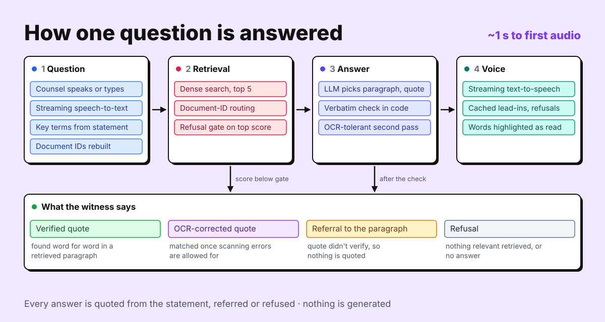

<div align="center">

# Cross-examine

**Cross-examine a witness on their own statement, by voice. The witness can only answer by quoting the statement: every quote is checked word for word before it is spoken, and highlighted as it is read.**


[](LICENSE)

<!-- TODO: live URL -->
<!-- TODO: demo GIF -->
<!-- TODO: screenshot of the examination screen -->

<sub>A solo project for AssemblyAI's Voice Hackathon, October 2026, on witness statements from the Post Office Horizon IT Inquiry.</sub>

</div>

## Key results

- **Counsel's real questions, never used in development: 11 of 15 answered from the right paragraph,** 3 of 5 trap questions refused, and all 15 answers verified quotes.
- **Uploaded statements never used in development: 7 of 8 answered from the right paragraph,** 4 of 4 traps refused.
- **Nothing unverified is spoken.** On the example witness, 83 of 83 answers over 3 runs were verified quotes, and 27 of 28 answerable questions were answered from the right paragraph in every run.
- **About a second to the witness's voice:** question to first audio p50 1.06 s, p95 2.25 s over 35 spoken questions.

## Contents

1. [What it does](#1-what-it-does)
2. [Example](#2-example)
3. [Architecture](#3-architecture)
4. [How it works](#4-how-it-works)
5. [Evaluation](#5-evaluation)
6. [Limitations](#6-limitations)
7. [Run it locally](#7-run-it-locally)
8. [Project structure](#8-project-structure)
9. [Acknowledgements, licence and contact](#9-acknowledgements-licence-and-contact)

## 1. What it does

Practising cross-examination needs a witness who sticks to their evidence. A language model playing the witness will happily invent a convenient answer, and counsel can't tell. That makes it worse than useless for preparation: you rehearse against testimony that doesn't exist.

Here the witness can only answer by quoting their own written statement. The model picks the paragraph and the words, and code checks the words are really there before anything is spoken. You can use the example witness or upload a statement PDF, then ask questions by voice or by typing. Each answer is one of:

- **A verified quote:** spoken, with the words highlighted in the statement as they are read and the paragraph number shown as a badge.
- **A refusal:** "That is not something I addressed in my witness statement." Nothing relevant was retrieved, or the model found no paragraph that answers.
- **A referral:** "I'd refer you to paragraph N of my statement." The model's quote did not verify, so nothing is quoted and the paragraph is highlighted whole.
- **An OCR-corrected quote:** for scanned statements with OCR errors ("lama" for "I am a"). Every word lined up once those errors were allowed for, so the witness says the corrected words and the original words are highlighted.
- **A document answer:** a question citing a document ID (POL00055418) is answered from the paragraphs that cite it. An ID that isn't in the statement gets "I don't recognise that document reference".

## 2. Example

> **Counsel:** Did you personally carry out audits?
>
> **Witness:** To be clear: I did not personally carry out audits. `¶ 56`

The words "I did not personally carry out audits." are highlighted in paragraph 56 as they are spoken.

## 3. Architecture

<p align="center"></p>

[](https://gitdiagram.com/ishaan-bhalla/cross-exam?utm_source=readme&utm_medium=picture)

*Top: how one question is answered. Bottom: the code's parts (GitDiagram; click to explore it interactively).*

## 4. How it works

- **Statements.** A PDF is parsed from its text layer, with OCR for scanned pages, into numbered paragraphs (12, 12.1, 7(a)) and section labels. Acronyms and document IDs become key terms for speech-to-text, and document IDs split up in the transcript are rebuilt (POL00055418).
- **Retrieval.** Dense embeddings (BAAI/bge-small-en-v1.5, run locally) return the top 5 paragraphs. If the best score is below a gate, the witness refuses before the LLM is called. Questions citing a document ID go to the paragraphs that cite it.
- **Extractive answers.** The LLM (via AssemblyAI's LLM Gateway, temperature 0) returns a paragraph, a quote of at most 60 words and a short lead-in as JSON. Code checks the quote appears verbatim in a retrieved paragraph. If it doesn't, an OCR-tolerant second pass is tried, and if that fails too the witness refers to the paragraph instead of quoting.
- **Voice.** One streaming TTS session per examination. Lead-ins and refusals are synthesised in advance in the chosen voice, so first audio starts as soon as the answer is known. Word timings drive the highlighting.
- **Upload flow.** An LLM drafts the witness's profile (name, role). Every field is checked against the text and linked to its source, and the user confirms it and picks a voice. Uploads are held in memory only unless `PERSIST_UPLOADS` is on.
- **Retries and errors.** A rate-limited LLM call (HTTP 429) is retried up to 4 times; other failures show an error and the question can be asked again. A dropped TTS session is reopened, and audio still plays if word timings never arrive. If the microphone or speech-to-text fails, you can type instead. There is no backup model.
- **Cost and latency logging.** Every answer records LLM calls and tokens, TTS characters and audio seconds, STT audio seconds and latency. Add `?debug` to the examination URL to see them under each answer.
- **Why no local option.** The app is built on AssemblyAI's voice stack. Embeddings and OCR run locally, but swapping in local speech or language models would change every measured number. An uploaded statement's text is sent to AssemblyAI to run the examination.

## 5. Evaluation

The statements come from the [Post Office Horizon IT Inquiry](https://www.postofficehorizoninquiry.org.uk/), which publishes them. The example witness is Rod Ismay's [first witness statement](https://www.postofficehorizoninquiry.org.uk/evidence/witn04630100-rod-ismay-first-witness-statement). Counsel's questions come from the transcript of his oral evidence on [11 May 2023](https://www.postofficehorizoninquiry.org.uk/hearings/phase-3-11-may-2023).

**Test sets**

| Set | Questions | What it is |
|---|---|---|
| Ismay dev | 35 | Written against the statement: direct, paraphrased, multi-paragraph, document references and 6 traps. Every setting was tuned on it, so its numbers are optimistic. |
| Ismay held-out | 20 | Counsel's real questions from the hearing (15 answerable, 5 traps), labelled against the statement and run once. |
| Upload dev | 20 | 3 uploaded statements (one mostly scanned, one with sub-paragraphs, one 168 pages). Used to decide the reranker and OCR changes. |
| Upload held-out | 12 | 2 statements not used before, written and checked before a single run. |

A trap is a question the statement doesn't answer, such as an Inquiry topic the witness never mentions, so the right response is a refusal.

**Results** (`qwen3.5-4b-32k-fast`, temperature 0, 23–24 Oct 2026)

| Set | Runs | Right paragraph | Verified quotes | Traps refused | Source |
|---|---|---|---|---|---|
| Ismay held-out (counsel) | 1 | **11 of 15** | 15 of 15 | 3 of 5 | [ismay_heldout](eval/results/run_20261024_ismay_heldout.json) |
| Upload held-out | 1 | **7 of 8** | 7 of 8 | 4 of 4 | [upload_heldout](eval/results/run_20261023_upload_heldout.json) |
| Ismay dev | 3 | 27 of 28 | 100% | 6–7 of 7 | [ismay_dev](eval/results/run_20261024_ismay_dev.json) |
| Upload dev | 3 | 10 of 14 | 13–14, plus 2 OCR-corrected | 4–5 of 6 | [upload_dev](eval/results/run_20261024_upload_dev.json) |

Counsel's questions are harder than the dev set: the right paragraph is ranked first for 8 of 15 (25 of 28 on dev) and in the top 5 for 14 of 15. Of the 4 misses, 2 were refused and 2 quoted a real but wrong paragraph. On the 8 questions whose labels are marked high-confidence, the right paragraph was cited for 7. The upload held-out run was made before referrals existed; its one unverified answer would now be a referral to the right paragraph.

**What was tried, and kept or left off** (Ismay dev, 28 answerable questions)

| Change | Right paragraph | Decision |
|---|---|---|
| Dense retrieval against BM25 | 27 against 20 | Kept dense |
| Hybrid (dense + BM25) | 27 in the top 5, but 23 first against dense's 25 | Left off |
| HyDE query expansion | 22–24 | Left off |
| LLM relevance check | 22–23; p50 latency 2,025 ms against 1,104 ms | Left off |
| Cross-encoder reranker (MiniLM, bge) | 26, 25; no gain on uploads | Left off |
| Document-ID routing | 4 of 4 document questions first, against 2 of 4 | Kept |
| OCR-tolerant verification (upload dev) | 2 referrals became spoken quotes; nothing else changed | Kept |

**Latency, stability and cost**

| | Result |
|---|---|
| Answer decided, p50 / p95 | 1,104 / 2,505 ms (dev), 1,087 / 1,782 ms (counsel) |
| Question to first audio, p50 / p95 | 1,063 / 2,250 ms (35 spoken questions) |
| Question to the quote's first audio, p50 / p95 | 1,428 / 3,092 ms |
| Refusal audio starting, when decided before the LLM | 5–13 ms |
| Same answer in all 3 runs | 34 of 35 dev, 18 of 20 upload dev questions |
| Per answer (mean) | 0.97 LLM calls, 815 / 52 tokens in / out, 129 TTS characters (7.6 s of audio) |
| Cost in US dollars | Not measured (see below) |

The spoken run excludes rate-limit waits (2 of 35 questions waited, 71 s in total). Cost isn't given because the rates aren't public. AssemblyAI's [pricing page](https://www.assemblyai.com/pricing) (28 Sep 2026) lists streaming STT at $0.45 per hour of open session, which is a cost per examination rather than per answer. Neither this LLM nor the streaming TTS preview is on the price list; set the `COST_*` rates in `.env` to estimate it.

Every result file in [`eval/results/`](eval/results/) holds the settings, git commit, counts for each run and every question's outcome. The full experiment log is in [`docs/results.md`](docs/results.md).

## 6. Limitations

- **A verified quote isn't always the right answer.** Verification proves the words are in the statement, not that they answer the question. "Before 2014, who had the final say on stopping a postmaster from running their branch?" quotes ¶106 when the answer is ¶99, which ranks 119th because the question avoids its words ("suspend", "Contract Advisor").
- **Retrieval can miss the paragraph.** "Did your own department rely on the same IT as sub-postmasters?" is refused because ¶28 ranks 21st, so the model never sees it.
- **Named things the statement never mentions.** "You were aware by this time about the Callendar Square bug, weren't you?" quotes a real paragraph about Horizon, though the bug is never mentioned. The refusal gate can't separate these on counsel's questions: traps scored up to 0.709, answerable questions as low as 0.606.
- **One paragraph per answer.** A two-part question gets only the first part answered.
- **Small sets, tuned on one witness.** One question moves a rate by 4 to 13 points, and the gate (`DENSE_MIN_SCORE=0.56`) was chosen on the Ismay dev set.
- **Preview TTS.** The streaming TTS WebSocket had no public documentation; the protocol was worked out by probing ([`docs/api_feedback.md`](docs/api_feedback.md)) and may change.
- **One model, no fallback.** A gateway outage or a long rate limit stops answers.
- **Not legal advice.** It's a practice tool.

**What's next:** answers that quote more than one paragraph; refusing questions about cases, people or events the statement never names; and putting one witness's evidence to another.

## 7. Run it locally

Needs [conda](https://docs.conda.io/en/latest/miniconda.html) (or Python 3.11 and pip), an [AssemblyAI API key](https://www.assemblyai.com/dashboard/signup), and Node 20+ only for the browser tests. The conda environment installs Tesseract for scanned statements.

```bash
git clone https://github.com/ishaan-bhalla/cross-exam.git && cd cross-exam
conda env create -f environment.yml -p ./venv
conda activate ./venv
pip install -e .
cp .env.example .env    # set ASSEMBLYAI_API_KEY; every setting is documented there

# Example witness: save Rod Ismay's first statement (link above) as
# "data/raw/WITN04630100 - Rod Ismay - First Witness Statement.pdf"
python scripts/serve.py    # http://127.0.0.1:8000

pytest                           # tests needing data/ or an API key skip without them
node --test tests/web/*.test.mjs

python scripts/run_eval.py --questions ismay_questions.jsonl \
  --pdf "data/raw/WITN04630100 - Rod Ismay - First Witness Statement.pdf" \
  --witness "Rod Ismay" --repeats 3 --save-as ismay_dev           # dev set
python scripts/run_live_eval.py --witness ismay \
  --questions ismay_questions.jsonl --save-as ismay_live         # spoken latency
python scripts/run_upload_spotcheck.py \
  --questions upload_spotcheck.jsonl --repeats 3 --save-as upload_dev   # uploads (needs data/raw/statements/)
```

The other runs are the same commands with one setting changed; each result file's `notes` and `settings` record which.

## 8. Project structure

```
src/crossexam/
  api/          FastAPI app: examination WebSocket, uploads, witnesses, conversations
  clients/      AssemblyAI LLM Gateway and streaming TTS clients
  retrieval/    dense, BM25, hybrid, reranker; refusal gate and document-ID routing
  statements/   PDF parser (text layer and OCR, numbered paragraphs) and STT key terms
  witness/      answer step, quote verification, OCR-tolerant matching, alignment, profile
  web/          plain HTML, CSS and JS front end (no build step)
prompts/        LLM prompts, lead-ins and fixed phrases
eval/           question sets; eval/results/ holds the cited run summaries
scripts/        serve and the evals
tests/          pytest suite; tests/web/ for the browser logic
docs/           results log, design notes, API feedback
```

Python 3.11 · FastAPI · fastembed · pypdf, pypdfium2 and Tesseract · AssemblyAI streaming STT, streaming TTS and LLM Gateway · plain HTML, CSS and JavaScript

## 9. Acknowledgements, licence and contact

- [AssemblyAI](https://www.assemblyai.com/) for speech-to-text, text-to-speech and the LLM Gateway, and for the Voice Hackathon.
- [fastembed](https://github.com/qdrant/fastembed), the [BGE](https://huggingface.co/BAAI/bge-small-en-v1.5) embedding models from BAAI, and [Tesseract OCR](https://github.com/tesseract-ocr/tesseract).
- The [Post Office Horizon IT Inquiry](https://www.postofficehorizoninquiry.org.uk/), for publishing its evidence.

Licence: [MIT](LICENSE), © 2026 Ishaan Bhalla.

Built by **Ishaan Bhalla**: [LinkedIn](https://www.linkedin.com/in/bhalla-ishaan) · [bhallaishaan23@gmail.com](mailto:bhallaishaan23@gmail.com)
